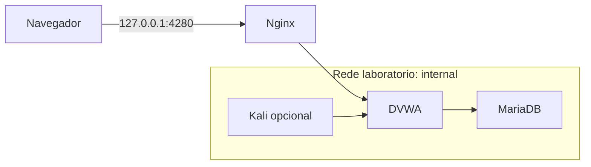

# Executar o DVWA com Docker

O laboratório contém DVWA, MariaDB e proxy Nginx, com Kali e Medusa como perfil opcional. Requer Docker com suporte a containers Linux, Docker Compose, Python 3 e a porta local 4280 livre. As versões utilizadas estão em [ambientes.md](ambientes.md).

## Arquitetura



DVWA, banco e Kali usam somente a rede interna `laboratorio`. Apenas o proxy publica uma porta e participa também da rede bridge `entrada`, que possui conectividade externa. Ele encaminha requisições a um único destino, `dvwa:80`. O arquivo de configuração do Nginx é montado somente para leitura.

Os downloads e o build usam a conexão do Docker; o isolamento da rede interna se aplica aos containers em execução. Os limites de memória são 128 MB para o proxy, 256 MB para DVWA, 384 MB para o banco e 256 MB para o Kali opcional, além do consumo do Docker/WSL.

## Iniciar

Na raiz do repositório:

```sh
python scripts/preparar-ambiente.py
docker compose config --quiet
docker compose pull web dvwa db
docker compose up -d --wait
```

O script gera as senhas do banco em `.env`, sem exibir os valores ou sobrescrever um arquivo existente. Esse arquivo é ignorado pelo Git. A saída de `docker compose config` sem `--quiet` pode revelar as credenciais expandidas.

No primeiro uso, abra **http://127.0.0.1:4280/setup.php** e inicialize o banco exclusivo do DVWA. O botão de criação/reset apaga e recria os dados desse banco. Use uma conta de demonstração conforme a [documentação do DVWA](https://github.com/digininja/DVWA#docker-container).

O nível inicial é `impossible`. Altere-o em **DVWA Security** para realizar a comparação.

## Conferir a execução

```sh
docker compose ps
docker network inspect medusa-lab_laboratorio --format '{{.Internal}}'
docker compose port web 80
```

A rede deve indicar `true`, e a porta publicada deve ser `127.0.0.1:4280`. Apenas o proxy deve participar de duas redes. As verificações da execução registrada estão na [validação final](evidencias/validacao-docker-2026-11-14.json).

## Comparar os controles

No módulo **Brute Force**, use uma conta fictícia e uma senha conhecida:

1. Em **Low**, faça duas tentativas inválidas e uma válida.
2. Em **Impossible**, faça três tentativas inválidas e depois forneça a senha válida. Observe a resposta de bloqueio e encerre a sequência.
3. Compare mensagens, tempos e registros. Consulte a fonte instalada do módulo para identificar os controles.

O exercício compara autenticação e bloqueio; não demonstra descoberta de uma senha desconhecida. Um status HTTP 200 não distingue sucesso de falha: confira o conteúdo da resposta. Em Impossible, preserve a sessão e use os tokens exigidos pelo formulário.

O [relatório Docker](relatorio-docker.md) apresenta os resultados coletados com cliente HTTP Python, os digests das imagens e os limites da comparação. Os logs do Apache podem conter credenciais em URLs; sanitize os trechos antes de compartilhá-los. O log do proxy omite parâmetros, cookies e cabeçalhos de autenticação.

## Kali opcional

```sh
docker compose --profile ferramentas build kali
docker compose --profile ferramentas run --rm kali medusa -V
docker compose --profile ferramentas run --rm kali curl -I http://dvwa/login.php
docker compose --profile ferramentas run --rm kali bash
```

Dentro do Kali, a aplicação está em `http://dvwa/`; no navegador do hospedeiro, em `http://127.0.0.1:4280/`. O perfil usa um usuário sem privilégios. Sua construção não foi concluída na execução documentada e ele não foi usado nos testes web.

## Encerrar

```sh
docker compose --profile ferramentas down
```

O comando remove os containers e a rede, preservando o banco. Para descartar também o volume do banco exclusivo do laboratório:

```sh
docker compose --profile ferramentas down --volumes
```

O `.env` permanece no hospedeiro. Alterar suas senhas não atualiza as contas de um banco já inicializado; para recriar o laboratório descartável, remova o volume antes de regenerar as credenciais.
